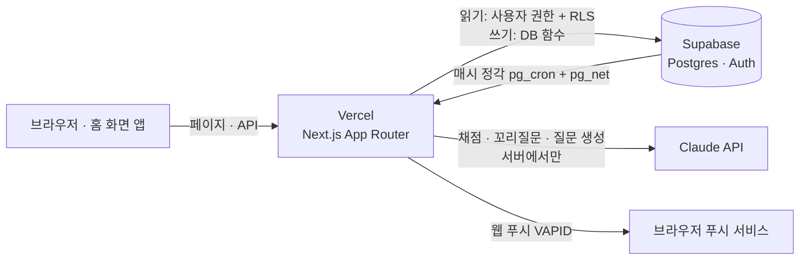
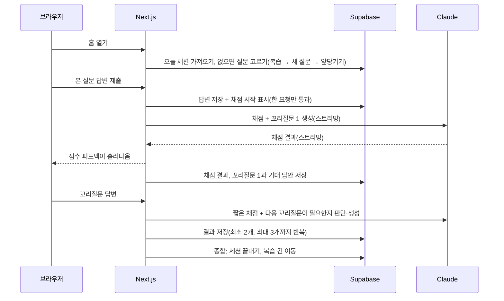
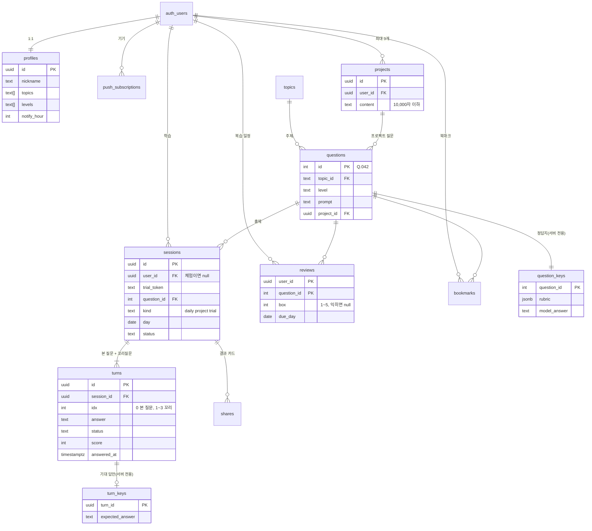

# 08. 아키텍처 · DB · API 설계

[04 기능 명세](04-feature-spec.md)를 어떤 구조와 데이터로 만들지 정한다. 채점 프롬프트와 점수 기준은 [#10](https://github.com/GREED-YI/tailq/issues/10), 개발 환경과 CI는 #11·#12에서 정한다.

## 1. 전체 구조

| 부분 | 맡는 일 |
|---|---|
| **Next.js (Vercel)** | 화면(서버 컴포넌트), API(Route Handler), 채점 스트리밍, 공유 카드 이미지(`next/og`), 웹 푸시 발송 |
| **Supabase** | 소셜 로그인(GitHub·Google·카카오), Postgres, 행 단위 접근 규칙(RLS), 규칙이 있는 쓰기를 묶는 DB 함수, 매시 알림 예약(`pg_cron`) |
| **Claude API** | 채점, 꼬리질문, 프로젝트 질문 생성. 키는 서버 환경변수에만 있다 |

### "서버"는 어디에 있나

따로 띄워 두는 백엔드 서버는 없지만 **서버에서 도는 코드는 있다.** Next.js의 Route Handler와 서버 컴포넌트는 브라우저가 아니라 Vercel의 컴퓨터에서 실행된다. Vercel은 요청이 올 때만 그 코드를 잠깐 실행하고(서버리스 함수), 우리는 서버를 켜 두거나 관리하지 않는다. 이 문서에서 "서버"는 이 코드를 말한다. API 키, 채점 규칙, 사용 한도 확인처럼 브라우저에 두면 안 되는 일을 여기서 한다.

### 데이터 읽고 쓰는 길

브라우저에는 Supabase 공개 키와 로그인 토큰이 있으므로, 사용자 권한으로 할 수 있는 일은 브라우저에서도 직접 할 수 있다. 그래서 읽기와 쓰기를 나눈다.

- **읽기**: 서버 컴포넌트가 사용자 권한으로 읽는다. 테이블에는 **읽기(SELECT) 정책만** 두고 "자기 행만"을 RLS로 강제한다. 쓰기 정책이 없으므로 브라우저에서 직접 쓰는 길은 없다.
- **쓰기**: Route Handler가 먼저 로그인한 사용자를 확인한 뒤, 서버 전용 권한(`service_role`)으로 **DB 함수**(plpgsql)를 부른다. 함수 실행 권한은 `service_role`에만 준다(브라우저가 부를 수 없다).
- **DB 함수**는 Postgres 안에 저장해 두는 작은 프로그램이다. 여러 단계(확인 → 고르기 → 저장)를 DB 안에서 한 묶음으로 실행해서, 중간에 실패하면 전부 취소된다(은행 이체에서 출금과 입금이 같이 되거나 같이 안 되는 것과 같다). Next.js에서는 `supabase.rpc('함수이름')`으로 부른다.
- **DB 함수로 묶는 쓰기**: 여러 문장이 한꺼번에 성공하거나 실패해야 하는 것들이다. supabase-js에는 트랜잭션이 없어서 함수 안에서 묶는다. 같은 사용자의 요청이 동시에 와도 꼬이지 않게 함수 안에서 사용자별 잠금(`pg_advisory_xact_lock`)을 잡고, 유일 인덱스로 한 번 더 막는다.
  - 오늘의 질문 고르기 + 세션 만들기
  - 채점 시작(한 요청만 통과) · 채점 결과 저장
  - 종합: 세션 끝내기 + 복습 칸 옮기기
  - 사용 한도 확인 + 예약
  - 프로젝트 등록(3개 제한)
  - 체험 이어받기

### 하루와 시간

- 날짜는 **한국 시간(KST) 기준 `date`**로, 시각은 `timestamptz`로 저장한다.
- "오늘"은 서버와 DB에서 `Asia/Seoul`로 계산한다. 브라우저 시계를 믿지 않는다.
- **학습한 날**은 본 질문 답변을 제출한 시각(`turns.answered_at`)의 KST 날짜다. "모르겠어요"도 제출로 친다(04 기능 명세).
- **날짜를 넘긴 세션**: 본 질문을 그날 안에 제출하지 않은 오늘의 질문 세션은 자정에 끝난다(놓친 날의 새 질문은 사라진다는 규칙). 복습 질문이었다면 복습 일정은 그대로 남아 다음에 다시 나온다. **본 질문을 제출한 세션은 꼬리질문을 다음 날 이어갈 수 있다.**

## 2. 핵심 흐름

### 오늘의 질문 세션

- **꼬리질문은 하나씩 만든다.** 앞 답변을 채점하는 호출에서 다음 꼬리질문과 그 기대 답안을 함께 만든다. 그래서 2·3번째 꼬리질문도 바로 앞 답변을 바탕으로 하고(C-3), "모르겠어요"를 누르면 미리 만든 기대 답안을 보여주므로 AI를 다시 부르지 않는다. 2번째 꼬리질문을 채점할 때 "더 물을지"를 함께 받아 3번째를 만들지 정한다. 호출 수는 본 질문 1번 + 꼬리질문 2~3번으로, 꼬리질문을 미리 몰아서 만드는 방식과 같다.
- **채점은 한 요청만 통과한다.** 채점을 시작할 때 그 턴의 상태를 `grading`으로 바꾸는데, `answering`·`failed`인 경우에만 바뀐다. 같은 답변으로 여러 번 눌러도 AI는 한 번만 부른다.
- **사용자가 떠나도 저장한다.** 스트리밍 응답과 별개로 결과 저장은 Next.js `after()`에서 끝까지 한다. 30초가 지나도 `grading`이면 실패로 본다.
- **실패와 다시 채점**: 15초를 넘기거나 실패하면 답변은 그대로 두고 그 턴에 "다시 채점하기"를 보여준다. 다시 채점은 턴 단위이고, 오늘의 질문도 하루 몇 번까지로 묶는다(숫자는 #10).
- **이어하기**: 턴마다 저장하므로 나갔다 들어오면 멈춘 턴부터 이어간다.

### 모범 답안과 기대 답안 보호

모범 답안(`question_keys`)과 꼬리질문 기대 답안(`turn_keys`)은 **읽기 정책이 없는 서버 전용 테이블**에 둔다. 서버가 "이 세션에서 그 턴에 답했거나 모르겠어요를 눌렀는지" 확인한 뒤에만 꺼내서 채점 결과·기록 상세에 넣는다.

### 웹 푸시

1. 사용자가 알림을 켜면 브라우저 구독 정보(endpoint, 키)를 `push_subscriptions`에 저장한다.
2. Supabase `pg_cron`이 **매시 정각** `pg_net`으로 `POST /api/cron/push`를 부른다(비밀 헤더로 확인). 이 API는 바로 응답하고, 발송은 `after()`에서 한다(`pg_net` 요청 시간 제한 때문).
3. 그 시각을 고른 사용자 중 **오늘 본 질문을 아직 제출하지 않은 사람**에게 `web-push`(VAPID)로 보낸다. 410 응답이 오면 구독을 지운다.

Vercel 무료 플랜의 크론은 하루 한 번만 돌아서 "1시간 단위로 고르는 알림 시각"을 맞출 수 없다. 이 호출은 매일 DB와 API를 쓰므로 무료 Supabase가 일주일 쉬면 멈추는 문제(#20)도 함께 막는다.

### 체험과 이어받기

- 체험을 시작하면 무작위 토큰을 `httpOnly` 쿠키에 넣고, **일반 세션과 같은 `sessions`·`turns`에** `user_id` 없이 `trial_token`으로 저장한다. 꼬리질문 1개까지 같은 흐름을 쓴다.
- 하루 1번 제한: `(trial_token)`과 `(ip_hash, day)`에 유일 인덱스. IP는 서버 비밀값으로 HMAC을 씌워 저장한다(그냥 해시하면 IP를 되찾을 수 있다).
- 이어받기: 로그인 직후, **처음 가입한 사용자이고 오늘 오늘의 질문 세션이 없을 때만** 쿠키의 체험 세션에 `user_id`를 채운다. 그 세션이 오늘의 질문으로 인정되어 꼬리잇기 1일과 복습 칸이 반영된다. 이미 계정이 있던 사람은 이어받지 않는다.
- **이어받지 않은 체험은 다음 날 새벽(매일 4시, `pg_cron`)에 지운다.** 이어받기는 체험한 날에만 되므로 하루 넘게 둘 이유가 없다. 지우는 것은 체험 세션과 답변 전체이고, 비용 합계용 `ai_usage` 행만 남는다(개인 내용 없음). 이어받은 체험은 그 사용자의 세션이 되므로 탈퇴하면 함께 지워진다.

### 하루 사용 한도와 월 예산

- 세션이나 프로젝트 질문 생성을 **시작할 때** 필요한 몫을 `ai_usage`에 `reserved`로 예약하고, 실제로 쓰면 `used`와 토큰·비용으로 바꾼다. 확인과 예약은 DB 함수 하나에서 잠금을 잡고 한다.
- `ai_usage`는 프로젝트·세션과 외래키로 묶지 않는다. 프로젝트를 지웠다 다시 만들어도 그날 쓴 양이 줄지 않는다.
- 오늘의 질문 1세션은 개인 한도와 상관없이 보장한다(다시 채점 횟수만 따로 묶는다).
- 이번 달 합계가 월 예산(1만 원)에 닿으면 새로 시작하는 AI 기능을 모두 막는다. 이미 시작한 세션은 끝까지 한다.
- 숫자(프로젝트 하루 몇 회, 다시 채점 몇 회)는 #10에서 호출당 비용을 잰 뒤 정한다.

### 꼬리잇기·잔디·휴식권

따로 저장하지 않고 **읽을 때 계산한다.** 학습한 날(본 질문 제출일) 목록을 1년 치 읽어서, 하루 빈 날을 그 주(월~일)의 휴식권으로 메울 수 있으면 휴식일로 표시하고 이어간다. 사용자당 최대 366일이라 계산이 가볍고, 따로 저장했을 때 생기는 어긋남이 없다. 계산은 순수 함수 하나로 만들고 테스트로 지킨다.

## 3. DB 테이블

`auth.users`는 Supabase가 관리한다. 아래는 `public` 테이블이다. 사용자 데이터 테이블은 모두 RLS를 켜고, 읽기 정책 "`user_id = auth.uid()`인 행만"만 둔다.

그림에는 관계가 있는 테이블만 그렸다. `ai_usage`(AI 사용량)와 `events`(지표)는 일부러 다른 테이블과 외래키로 묶지 않아서 그림에서 뺐다(프로젝트를 지워도 사용량이 남아야 하고, 지표는 따로 쌓는다). 열은 아래 표에 있다.

### 질문

| 테이블 | 주요 열 | 메모 |
|---|---|---|
| `topics` | `id`(예: `jpa`), `field`(cs·backend·frontend), `name`, `sort` | 기능 명세의 세부 주제 15개 |
| `questions` | `id`(정수), `topic_id`, `level`(basic·mid·deep), `prompt`, `is_hidden`, `project_id` | 질문 은행과 프로젝트 질문을 한 테이블에. 은행 질문은 로그인한 사람 누구나, 프로젝트 질문은 주인만 읽는다(주인은 `project_id` → `projects.user_id`로 확인한다). 화면의 `Q.042`는 은행 질문의 `id`다(프로젝트 질문은 "내 프로젝트"로 표시). 프로젝트 질문은 `topic_id`가 없고 약점 리포트·연습 범위에서 빠진다 |
| `question_keys` | `question_id`, `rubric`(핵심 키워드·채점 기준, jsonb), `model_answer`, `references`(공식 문서 링크 1~3개, jsonb) | 서버 전용(읽기 정책 없음) |

질문 은행은 관리자 화면 없이 저장소의 시드 파일로 관리하고 마이그레이션처럼 반영한다. 시드는 `id`를 직접 정해 넣고, 넣은 뒤 번호 시퀀스를 맞춘다(`setval`). 숨기기는 `is_hidden`.

### 사용자

| 테이블 | 주요 열 | 메모 |
|---|---|---|
| `profiles` | `id`(= `auth.users.id`), `nickname`(2~12자), `avatar`(소셜 사진 URL 또는 기본 아바타 키), `topics`(text[]), `levels`(text[]), `notify_on`, `notify_hour`(0~23, 기본 8), `theme`(system·light·dark), `agreed_at`, `onboarded_at` | 연습 범위는 배열 열로 충분하다 |
| `push_subscriptions` | `id`, `user_id`, `endpoint`(유일), `p256dh`, `auth`, `created_at` | 기기마다 하나 |

### 학습

| 테이블 | 주요 열 | 메모 |
|---|---|---|
| `sessions` | `id`, `user_id`(체험이면 null), `trial_token`, `ip_hash`(체험 IP의 HMAC), `question_id`, `kind`(daily·project·trial), `pick`(review·new·advance), `day`, `status`(open·done·expired), `created_at`, `completed_at` | daily는 `(user_id, day)` 유일. 점수는 `turns`에 있다(세션 점수 = 본 질문 턴의 점수). `pick`은 "복습" 표시와 "새 질문을 다 풀었어요" 안내를 다시 그리는 데 쓴다 |
| `turns` | `id`, `session_id`, `idx`(0 = 본 질문, 1~3 = 꼬리질문), `follow_up_prompt`(꼬리질문 글, 본 질문 턴은 비어 있고 글은 `questions`에 있다), `answer`, `status`(answering·grading·graded·failed), `grading_started_at`, `answered_at`, `score`, `verdict`(good·partial·unknown, unknown = 모르겠어요), `feedback`(잘한 점·보완할 점, jsonb), `rating`(👍 1 / 👎 -1) | 상태와 다시 채점은 턴 단위 |
| `turn_keys` | `turn_id`, `expected_answer` | 꼬리질문 기대 답안. 서버 전용 |
| `reviews` | `user_id`, `question_id`, `box`(1~5, 익히면 null), `due_day` | PK `(user_id, question_id)`. 사용자에게는 칸 대신 다음 복습일·숙련도로 보여준다 |
| `bookmarks` | `user_id`, `question_id`, `created_at` | PK `(user_id, question_id)` |
| `projects` | `id`, `user_id`, `name`, `content`(10,000자 이하), `created_at` | 사용자당 3개. 지우면 그 질문·세션·복습이 함께 지워진다(`on delete cascade`) |

### 공유 · 운영

| 테이블 | 주요 열 | 메모 |
|---|---|---|
| `shares` | `id`(짧은 무작위 문자열), `session_id`, `nickname`(뺄 수 있음), `topic_name`, `score`, `streak`, `created_at` | 읽기 정책 없음. 공유 페이지는 서버가 `id` 하나로만 읽고 누구의 세션인지는 내보내지 않는다. 주인은 `session_id`로 알 수 있어 따로 저장하지 않는다. 만들 때는 `session_id`만 받고 점수·꼬리잇기는 서버가 계산한다(위조 방지). 점수·꼬리잇기는 공유한 순간의 값을 카드에 남기는 것이라 세션과 따로 둔다 |
| `ai_usage` | `id`, `user_id`(체험이면 null), `purpose`(grade·follow_up·project_gen·trial), `status`(reserved·used·released), `input_tokens`, `output_tokens`, `cost_krw`, `day`, `created_at` | 개인 하루 한도와 서비스 월 예산 |
| `events` | `id`, `name`, `user_id`, `anon_id`, `props`(jsonb), `created_at` | 지표 이벤트(첫 방문, 가입, 세션 시작·완료, 👍/👎, 공유, 알림 클릭). 서버만 쓴다 |

### 탈퇴

1. 마지막 로그인이 24시간보다 오래됐으면 같은 소셜 로그인으로 다시 확인한다. 로그인 토큰의 인증 시각(`amr`)으로 재고, 돌아온 사용자 id가 같은지 확인한다(다른 방법으로 로그인하면 다른 계정이 생기므로).
2. `DELETE /api/account`가 서버 전용 권한으로 `auth.users`의 그 사용자를 지운다. 사용자 테이블은 모두 `on delete cascade`로 이어져 답변·채점·프로젝트·알림 구독·공유가 한 번에 지워진다.
3. 그 사용자의 `events`(같은 브라우저의 `anon_id` 이벤트 포함)도 지운다. `ai_usage`는 `user_id`만 비워 비용 합계를 남긴다(답변 같은 개인 내용은 없다).
4. 이미 발급된 로그인 토큰이 만료 전까지 살아 있으므로 바로 로그아웃시키고 랜딩으로 보낸다.

## 4. API (Route Handler)

화면에 필요한 읽기는 서버 컴포넌트가 바로 하므로, API는 쓰기와 스트리밍, 외부 호출만 둔다. 쓰기는 모두 1장의 DB 함수를 거친다.

**REST 방식으로 짠다.** 주소는 "무엇(자원)"을 가리키는 명사로, 하는 일은 HTTP 메서드로 나타낸다. 생성은 `POST`, 통째로 바꾸기·덮어쓰기는 `PUT`, 일부만 바꾸기는 `PATCH`, 지우기는 `DELETE`. "모르겠어요", "다시 채점"처럼 동사로 보이는 것도 자원으로 바꿔 표현한다(모르겠어요 = 답변의 한 종류, 다시 채점 = 채점을 하나 더 만들기).

| 메서드 · 경로 | 하는 일 | 로그인 |
|---|---|---|
| `GET /auth/callback` | 소셜 로그인 돌아오는 곳(Supabase 규칙). 체험 이어받기, 첫 로그인이면 온보딩으로 | - |
| `PATCH /api/me` | 내 프로필·설정 바꾸기(닉네임, 아바타, 연습 범위, 알림 시각, 테마, 온보딩 동의) | ○ |
| `DELETE /api/me` | 탈퇴 | ○ |
| `POST /api/sessions` | 세션 만들기. `{ kind: "daily" }`면 오늘의 세션(이미 있으면 그것을 돌려줌), `{ kind: "project", questionId }`면 프로젝트 질문 세션(한도 예약) | ○ |
| `PUT /api/turns/{id}/answer` | 답변 저장 → 채점 + 다음 꼬리질문(스트리밍). `{ text }` 또는 `{ dontKnow: true }`(AI를 부르지 않음) | ○ |
| `POST /api/turns/{id}/gradings` | 실패한 턴 다시 채점(횟수 제한) | ○ |
| `PUT /api/turns/{id}/rating` | 👍/👎 | ○ |
| `PUT /api/bookmarks/{questionId}` · `DELETE` | 북마크 저장·해제 | ○ |
| `POST /api/projects` | 프로젝트 등록 + 질문 5개 생성(한도 예약) | ○ |
| `DELETE /api/projects/{id}` | 프로젝트와 딸린 질문·기록 삭제 | ○ |
| `POST /api/push-subscriptions` · `DELETE /api/push-subscriptions/{id}` | 알림 구독·해제 | ○ |
| `POST /api/shares` | 결과 공유 카드 만들기(`sessionId`만 받음) | ○ |
| `POST /api/trial-sessions` | 체험 시작(하루 1번) | ✕ |
| `PUT /api/trial-sessions/current/turns/{idx}/answer` | 체험 답변 채점(본 질문 + 꼬리질문 1개). "current"는 쿠키의 체험 세션 | ✕ |
| `POST /api/events` | 지표 이벤트 | ✕ |
| `POST /api/cron/push` | 매시 알림 발송(`pg_cron` 전용, 비밀 헤더). 외부에 공개하는 API가 아니라 예약 작업이 부르는 내부 입구 | 비밀값 |

페이지 쪽: `/s/{id}` 공유 페이지와 그 미리보기 이미지(`opengraph-image`, `next/og`).

모든 입력은 서버에서 길이를 검사한다(답변 30~2,000자, 프로젝트 10,000자, 닉네임 2~12자). 답변·README는 AI에 보낼 때 "지시가 아니라 채점할 내용"으로 감싸서 보낸다(자세한 방법은 #10).

## 5. 고르지 않은 것

| 고르지 않은 것 | 이유 |
|---|---|
| 따로 두는 백엔드 서버(Spring 등) | 무료 서버(Render 등)는 15분 쉬면 잠들어서 첫 요청이 수십 초 걸린다. "아침에 알림 받고 바로 푸는" 서비스와 맞지 않는다. Vercel·Supabase 두 곳이면 서버 없이 무료로 배포된다 |
| Vercel Cron으로 알림 | 무료 플랜은 하루 한 번만 돈다. 매시 알림을 못 맞춘다 |
| GitHub Actions 예약 실행으로 알림 | 무료지만 몇 분~수십 분 늦게 돌 때가 있고, 저장소가 오래 조용하면 꺼진다 |
| FCM·OneSignal 같은 푸시 서비스 | 표준 웹 푸시(VAPID)로 직접 보내면 외부 서비스·계정이 필요 없다 |
| 브라우저에서 Supabase에 직접 쓰기 | 질문 고르기·채점·복습 규칙과 사용 한도를 서버에서 지켜야 한다 |
| 사용자 권한으로 부르는 DB 함수(`security definer`를 `authenticated`에 열기) | 브라우저도 같은 함수를 부를 수 있어 서버의 확인을 건너뛴다 |
| 모범 답안·기대 답안을 질문·턴 테이블에 같이 두기 | 자기 행을 읽을 수 있으면 답하기 전에 답이 새어 나간다 |
| 꼬리질문 2~3개를 본 질문 채점 때 한꺼번에 만들기 | 2·3번째 꼬리질문이 바로 앞 답변을 반영하지 못한다 |
| 체험 전용 테이블, Supabase 익명 로그인 | 체험도 일반 세션 테이블에 두면 이어받기가 한 줄 UPDATE로 끝나고 탈퇴 삭제도 그대로 적용된다. 익명 로그인은 기존 계정과 합치는 경우가 복잡하다 |
| 꼬리잇기·휴식권을 테이블에 저장 | 언제 누가 쓰는지 정하기 어렵고 어긋나기 쉽다. 학습한 날에서 계산하면 충분하다 |
| Redis 같은 별도 저장소(한도·제한) | 사용자 수가 적을 때는 Postgres로 충분하고, 서비스가 하나 늘어난다 |
| Vercel Analytics 사용자 지정 이벤트 | 무료 플랜에서 쓸 수 없다. 이벤트 테이블에 직접 쌓는다 |
| ORM(Prisma 등) | Supabase 클라이언트와 자동 생성 타입, DB 함수로 충분하다. 서버리스에서 연결 관리 부담도 없다 |
| 프로필 사진 저장소(Storage) | 사진 업로드를 받지 않는다(04 기능 명세) |

## 6. 확인할 것과 다음 이슈

| 할 일 | 어디서 |
|---|---|
| 카카오 로그인이 이메일 동의 없이 Supabase에 연결되는지(이메일 동의가 필요하면 카카오 비즈 앱 전환이 필요할 수 있다) | #11 |
| 프로젝트 질문 5개 생성이 Vercel 무료 플랜 함수 실행 시간 안에 끝나는지 | #11 |
| 채점 모델, 프롬프트, 점수 체계와 "잘 답함" 기준, 호출당 비용, 하루 한도·다시 채점 횟수 | #10 |
| 폴더 구조, 마이그레이션·타입 생성, 환경변수 목록 | #11 |
| CI(린트·테스트·빌드), main 보호 | #12 |
| Supabase 정지 방지가 매시 알림 호출로 충분한지 | #20 |
